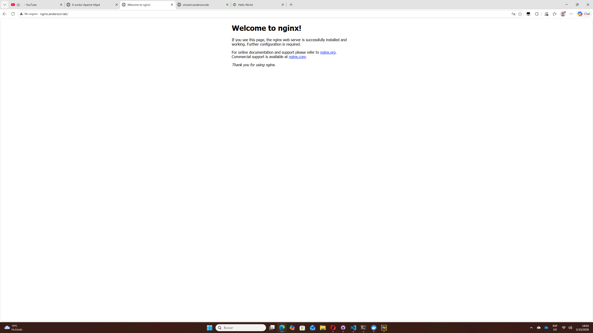
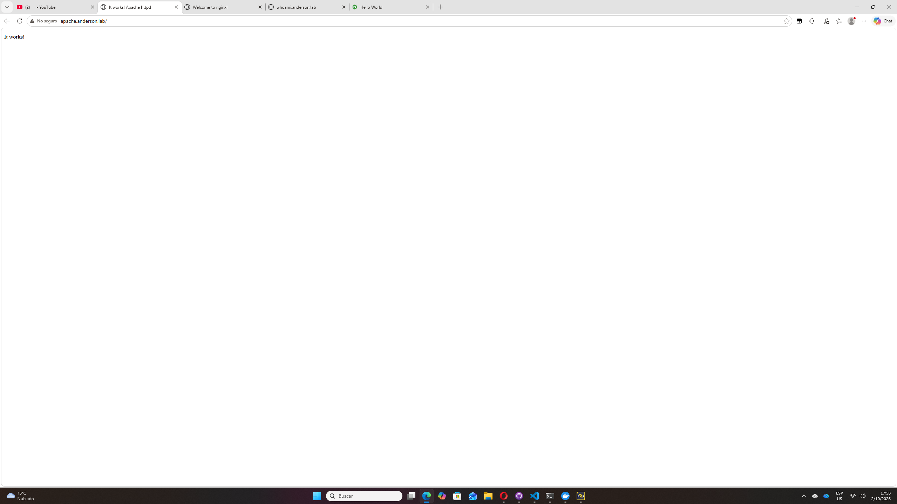
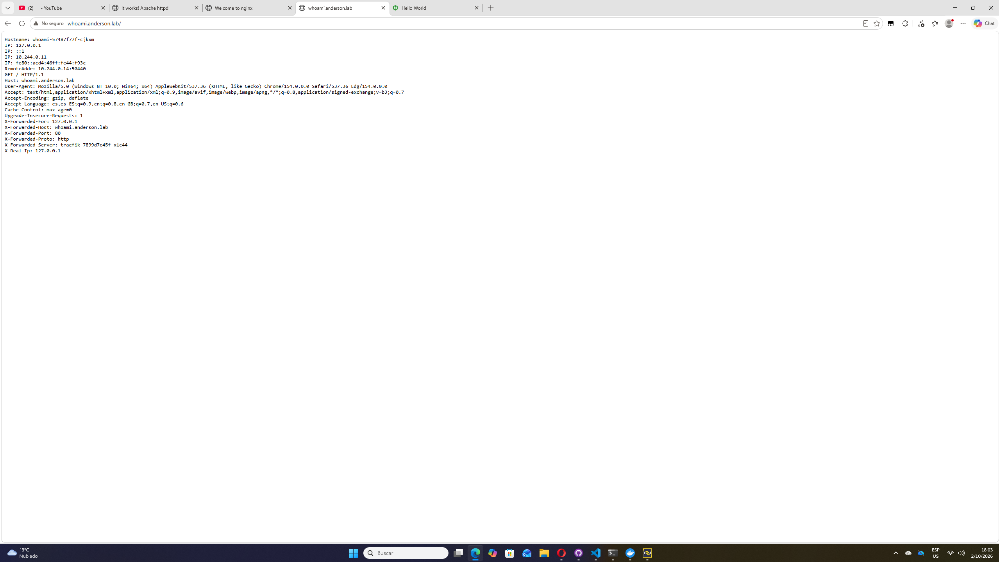
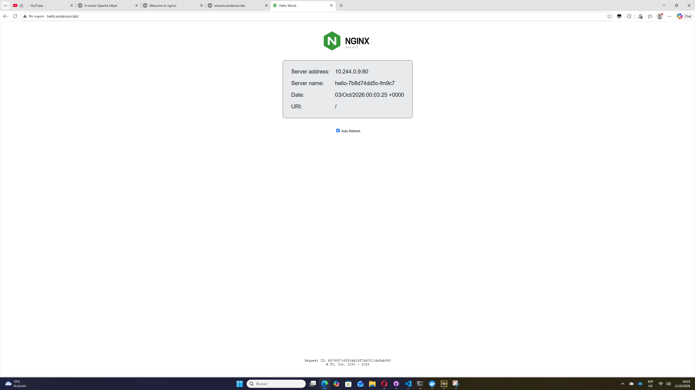

# Assessment 02 – MetalLB + Traefik + 4 aplicaciones web en Minikube

Despliegue declarativo (IaC, solo YAML, **sin Helm**) de:

- **MetalLB** como balanceador de carga L2 (namespace `metallb-system`).
- **Traefik v3.5** como Ingress Controller expuesto con un Service `LoadBalancer` (namespace `traefik`).
- **4 aplicaciones web** (nginx, apache, whoami, hello) con su Deployment, Service ClusterIP e IngressRoute (namespace `parcial-aonhl`).

Entorno: Windows 11, PowerShell, Minikube con driver Docker.

## Estructura del repositorio

```
k8s/
├── metallb/
│   ├── metallb-native.yaml     # Manifiesto oficial de MetalLB (CRDs, controller, speaker)
│   └── metallb-config.yaml     # IPAddressPool (1 IP) + L2Advertisement
├── traefik/
│   ├── namespace.yaml          # Namespace traefik
│   ├── crds.yaml               # CRDs de Traefik (IngressRoute, Middleware, ...)
│   ├── rbac.yaml               # ServiceAccount, ClusterRole y ClusterRoleBinding
│   ├── deployment.yaml         # Deployment de Traefik (entrypoint web :80, dashboard :8080)
│   └── service.yaml            # Service tipo LoadBalancer
└── apps/
    ├── namespace.yaml          # Namespace parcial-aonhl
    ├── nginx.yaml              # Deployment + Service + IngressRoute
    ├── apache.yaml
    ├── whoami.yaml
    └── hello.yaml
images/                         # Capturas de los 4 dominios en el navegador
```

## 1. Instalación de MetalLB

```powershell
kubectl apply -f k8s/metallb/metallb-native.yaml
kubectl wait -n metallb-system --for=condition=Ready pod --all --timeout=120s
kubectl apply -f k8s/metallb/metallb-config.yaml
```

`metallb-config.yaml` define un pool con **una sola IP** dentro de la red Docker de Minikube (`192.168.49.0/24`) y la anuncia en modo L2:

```yaml
apiVersion: metallb.io/v1beta1
kind: IPAddressPool
metadata:
  name: parcial-pool
  namespace: metallb-system
spec:
  addresses:
  - 192.168.49.200/32
---
apiVersion: metallb.io/v1beta1
kind: L2Advertisement
metadata:
  name: parcial-l2
  namespace: metallb-system
spec:
  ipAddressPools:
  - parcial-pool
```

Verificación:

```
> kubectl get pods -n metallb-system
NAME                          READY   STATUS    RESTARTS       AGE
controller-6c57b67fd4-gnzjg   1/1     Running   1 (146m ago)   146m
speaker-9844n                 1/1     Running   0              146m

> kubectl get ipaddresspool,l2advertisement -n metallb-system
NAME                                    AUTO ASSIGN   AVOID BUGGY IPS   ADDRESSES
ipaddresspool.metallb.io/parcial-pool   true          false             ["192.168.49.200/32"]

NAME                                    IPADDRESSPOOLS     IPADDRESSPOOL SELECTORS   INTERFACES   NODE SELECTORS
l2advertisement.metallb.io/parcial-l2   ["parcial-pool"]
```

## 2. Instalación de Traefik

```powershell
kubectl apply -f k8s/traefik/namespace.yaml
kubectl apply -f k8s/traefik/crds.yaml
kubectl apply -f k8s/traefik/rbac.yaml
kubectl apply -f k8s/traefik/deployment.yaml
kubectl apply -f k8s/traefik/service.yaml
```

- `rbac.yaml` da a Traefik permisos de lectura sobre Services, EndpointSlices, Secrets, Ingress y los CRDs `traefik.io`. Sin estos permisos aparecen errores `forbidden` en los logs.
- `deployment.yaml` usa `traefik:v3.5` con los proveedores `kubernetescrd` y `kubernetesingress`, entrypoint `web` en `:80` y dashboard en `:8080`.
- `service.yaml` es de tipo `LoadBalancer`, así que MetalLB le asigna la IP del pool.

Verificación:

```
> kubectl get pods,svc -n traefik
NAME                           READY   STATUS    RESTARTS   AGE
pod/traefik-7899d7c45f-xlc44   1/1     Running   0          21m

NAME              TYPE           CLUSTER-IP     EXTERNAL-IP      PORT(S)                       AGE
service/traefik   LoadBalancer   10.110.56.25   192.168.49.200   80:32106/TCP,8080:31895/TCP   143m
```

El Service tiene la anotación `metallb.io/ip-allocated-from-pool: parcial-pool`, lo que confirma que la IP la asignó MetalLB.

## 3. Aplicaciones, Services e IngressRoute

```powershell
kubectl apply -f k8s/apps/namespace.yaml
kubectl apply -f k8s/apps/
```

Cada archivo de `k8s/apps/` contiene tres objetos: un **Deployment**, un **Service ClusterIP** en el puerto 80 y un **IngressRoute** de Traefik en el entrypoint `web` con un dominio propio.

| App    | Imagen                    | Service      | IngressRoute  | Dominio               |
|--------|---------------------------|--------------|---------------|-----------------------|
| nginx  | `nginx:1.27`              | `nginx-svc`  | `nginx-route` | `nginx.anderson.lab`  |
| apache | `httpd:2.4`               | `apache-svc` | `apache-route`| `apache.anderson.lab` |
| whoami | `traefik/whoami:v1.10`    | `whoami-svc` | `whoami-route`| `whoami.anderson.lab` |
| hello  | `nginxdemos/hello:latest` | `hello-svc`  | `hello-route` | `hello.anderson.lab`  |

Ejemplo (`whoami.yaml`, IngressRoute):

```yaml
apiVersion: traefik.io/v1alpha1
kind: IngressRoute
metadata:
  name: whoami-route
  namespace: parcial-aonhl
spec:
  entryPoints:
    - web
  routes:
    - kind: Rule
      match: Host(`whoami.anderson.lab`)
      services:
        - name: whoami-svc
          port: 80
```

Verificación:

```
> kubectl get deploy -n parcial-aonhl
NAME     READY   UP-TO-DATE   AVAILABLE   AGE
apache   1/1     1            1           44s
hello    1/1     1            1           43s
nginx    1/1     1            1           43s
whoami   1/1     1            1           43s

> kubectl get endpointslices -n parcial-aonhl
NAME               ADDRESSTYPE   PORTS   ENDPOINTS     AGE
apache-svc-wn6pb   IPv4          80      10.244.0.15   43s
hello-svc-ljpbj    IPv4          80      10.244.0.16   43s
nginx-svc-2gvpx    IPv4          80      10.244.0.17   43s
whoami-svc-ctplh   IPv4          80      10.244.0.18   43s

> kubectl get ingressroute -n parcial-aonhl
NAME           MATCH                         SVC
apache-route   Host(`apache.anderson.lab`)   apache-svc
hello-route    Host(`hello.anderson.lab`)    hello-svc
nginx-route    Host(`nginx.anderson.lab`)    nginx-svc
whoami-route   Host(`whoami.anderson.lab`)   whoami-svc
```

## 4. DNS local (archivo hosts)

Se agregan los 4 dominios a `C:\Windows\System32\drivers\etc\hosts` (editarlo como Administrador):

```
127.0.0.1  nginx.anderson.lab
127.0.0.1  apache.anderson.lab
127.0.0.1  whoami.anderson.lab
127.0.0.1  hello.anderson.lab
```

Luego se abre el túnel hacia Traefik y se deja la terminal abierta:

```powershell
kubectl port-forward -n traefik svc/traefik 80:80
```

## 5. Limitación del driver Docker en Windows

Con el driver Docker, el nodo de Minikube es un contenedor dentro de la VM de Docker Desktop (WSL2). La red `192.168.49.0/24`, que incluye la IP `192.168.49.200` asignada por MetalLB, solo existe dentro de esa red Docker y **no es enrutable desde Windows**. Además, MetalLB en modo L2 responde ARP solo en esa red interna. Por eso:

- Si el archivo hosts apuntara a `192.168.49.200`, el navegador de Windows no podría llegar a esa IP.
- El archivo hosts apunta a `127.0.0.1`, y `kubectl port-forward` reenvía el puerto 80 local al Service `traefik`. Traefik recibe la cabecera `Host` original y enruta según el IngressRoute.

El LoadBalancer de MetalLB sí funciona. Se comprueba desde dentro del nodo, que está en la misma red que la IP (sección 6). Otra opción sería `minikube tunnel`, pero con el driver Docker en Windows tampoco expone la IP `192.168.49.200` al host.

## 6. Evidencia: acceso por la IP del LoadBalancer (192.168.49.200)

```powershell
foreach ($d in "nginx","apache","whoami","hello") {
  docker exec minikube curl -s -o /dev/null -w "$d.anderson.lab -> HTTP %{http_code}`n" -H "Host: $d.anderson.lab" http://192.168.49.200
}
```

Salida:

```
nginx.anderson.lab  -> HTTP 200   <title>Welcome to nginx!</title>
apache.anderson.lab -> HTTP 200   <title>It works! Apache httpd</title>
whoami.anderson.lab -> HTTP 200   Hostname: whoami-57487f77f-m48g7
hello.anderson.lab  -> HTTP 200   <title>Hello World</title>
```

Ninguno devuelve 404, así que cada `Host` llega a su IngressRoute y a su Service.

### Capturas en el navegador (vía port-forward)

**nginx.anderson.lab**



**apache.anderson.lab**



**whoami.anderson.lab**



**hello.anderson.lab**



## 7. Verificación de logs de Traefik

```powershell
kubectl logs deployment/traefik -n traefik --tail=50
```

No hay errores `forbidden` (el RBAC es correcto). Los únicos `ERR` son `no servers found for ...`, que aparecieron mientras los pods arrancaban y mientras se eliminaba el namespace anterior. Después ya no aparecen errores nuevos.
