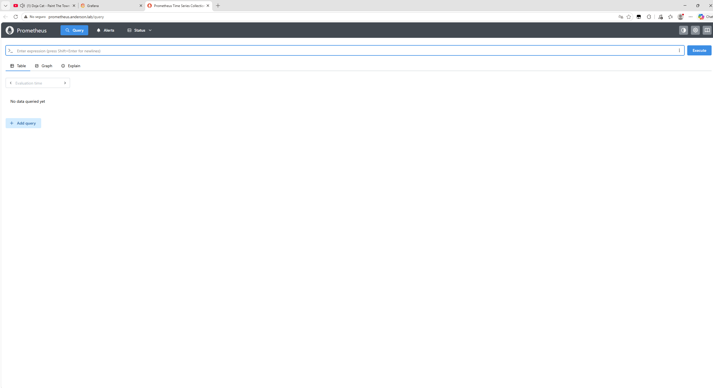
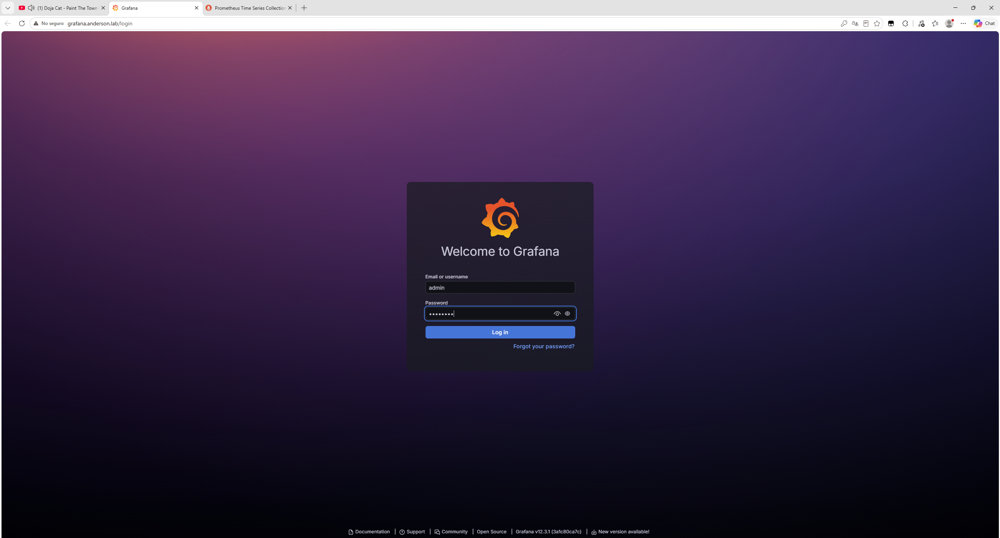
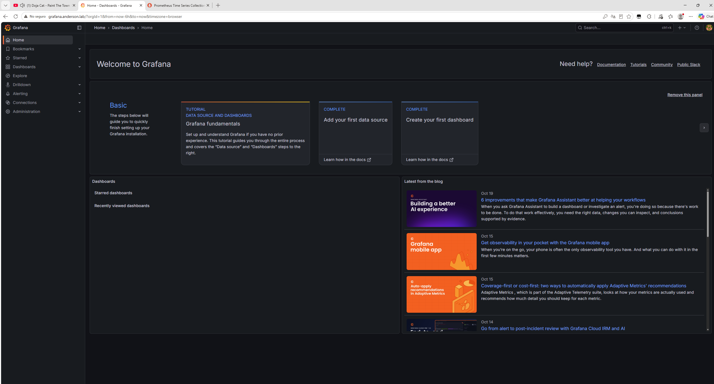
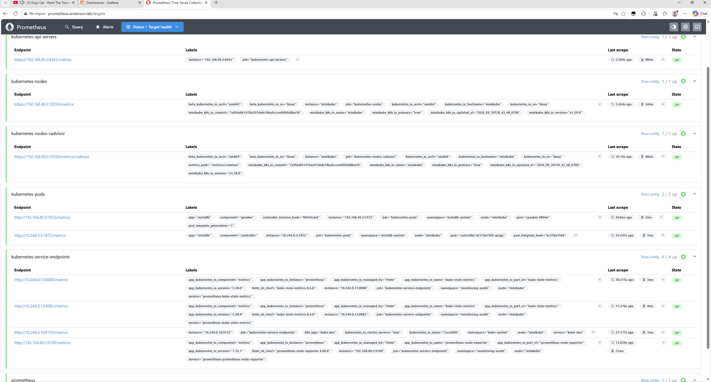
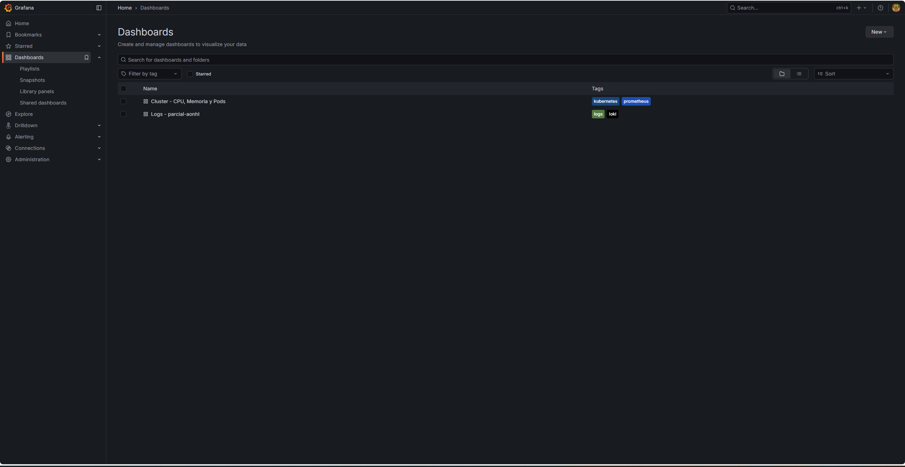
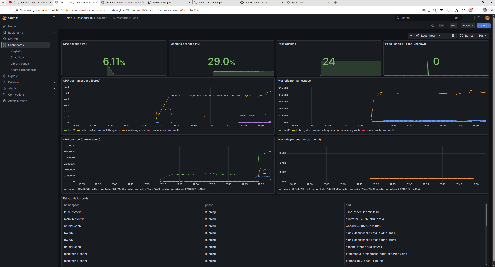
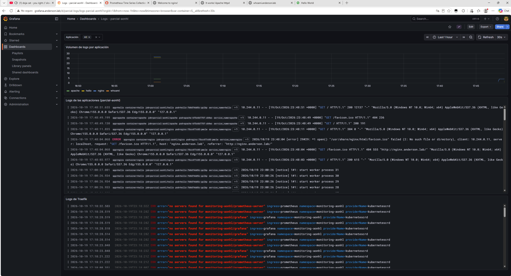

# Personal Project 01 – Monitoreo y centralización de logs

Stack de monitoreo instalado en el clúster de Minikube de la actividad anterior (Traefik + MetalLB):

- **Prometheus**: métricas del clúster (nodo, contenedores y estado de pods).
- **Loki**: almacenamiento de logs.
- **Promtail** (DaemonSet): recolecta los logs de las 4 apps de `parcial-aonhl` y de Traefik.
- **Grafana**: data sources y dashboards provisionados como código.

Todos los componentes viven en el namespace **`monitoring-aonhl`**. Grafana y Prometheus se exponen por Traefik con los dominios `grafana.anderson.lab` y `prometheus.anderson.lab`.

Entorno: Windows 11, PowerShell, Minikube (driver Docker), Helm 3.

## Estructura del repositorio

```
monitoring/
├── namespace.yaml                    # Namespace monitoring-aonhl
├── prometheus/values.yaml            # Chart prometheus-community/prometheus
├── loki/values.yaml                  # Chart grafana/loki (SingleBinary)
├── promtail/values.yaml              # Chart grafana/promtail (DaemonSet)
├── grafana/
│   ├── values.yaml                   # Chart grafana/grafana + provisioning de data sources
│   └── dashboards/
│       ├── kustomization.yaml        # Genera ConfigMaps con label grafana_dashboard=1
│       ├── cluster-metrics.json      # Dashboard de CPU, memoria y estado de pods
│       └── parcial-logs.json         # Dashboard de logs (apps de parcial-aonhl + Traefik)
├── traefik/
│   ├── ingressroute-grafana.yaml     # grafana.anderson.lab -> svc/grafana:80
│   └── ingressroute-prometheus.yaml  # prometheus.anderson.lab -> svc/prometheus-server:80
└── screenshots/                      # Evidencias
```

## Requisitos previos

Del assessment anterior deben estar funcionando:

```powershell
kubectl get pods -n metallb-system
kubectl get svc -n traefik          # traefik  LoadBalancer  EXTERNAL-IP 192.168.49.200
kubectl get deploy -n parcial-aonhl # nginx, apache, whoami, hello
```

Repositorios de Helm:

```powershell
helm repo add prometheus-community https://prometheus-community.github.io/helm-charts
helm repo add grafana https://grafana.github.io/helm-charts
helm repo update
```

Versiones instaladas (Helm v4.3.1):

| Release | Chart | Versión del chart | Versión de la app |
|---|---|---|---|
| `prometheus` | `prometheus-community/prometheus` | 29.37.0 | Prometheus v3.15.0 |
| `loki` | `grafana/loki` | 7.3.0 | Loki 3.6.12 |
| `promtail` | `grafana/promtail` | 6.17.1 | Promtail 3.5.1 |
| `grafana` | `grafana/grafana` | 10.5.15 | Grafana 12.3.1 |

> Helm marca algunos de estos charts como *deprecated* (Promtail está en fin de vida y su reemplazo es Grafana Alloy). Siguen funcionando y se usaron porque la actividad pide Promtail explícitamente.

## 1. Namespace

```powershell
kubectl apply -f monitoring/namespace.yaml
```

## 2. Prometheus

```powershell
helm upgrade --install prometheus prometheus-community/prometheus `
  -n monitoring-aonhl -f monitoring/prometheus/values.yaml
```

Configuración ([prometheus/values.yaml](monitoring/prometheus/values.yaml)):

- Se activan **kube-state-metrics** (métrica `kube_pod_status_phase`, estado de los pods) y **node-exporter** (CPU y memoria del nodo).
- Se desactivan Alertmanager y Pushgateway porque no se usan.
- Intervalo de scrape de 30s, retención de 7 días y volumen persistente de 5Gi.
- `server.baseURL` apunta a `http://prometheus.anderson.lab`.
- Los scrape jobs por defecto del chart recolectan métricas del clúster: `kubernetes-apiservers`, `kubernetes-nodes`, `kubernetes-nodes-cadvisor` (CPU y memoria por contenedor), `kubernetes-service-endpoints` (kube-state-metrics y node-exporter) y `kubernetes-pods`.

Con el release `prometheus`, el Service del servidor se llama `prometheus-server` (puerto 80).

## 3. Loki

```powershell
helm upgrade --install loki grafana/loki `
  -n monitoring-aonhl -f monitoring/loki/values.yaml
```

Configuración ([loki/values.yaml](monitoring/loki/values.yaml)):

- `deploymentMode: SingleBinary` con 1 réplica, suficiente para Minikube.
- Almacenamiento en `filesystem` (PVC de 5Gi) con esquema `v13` / `tsdb`.
- `auth_enabled: false` (un solo tenant) y retención de 168h.
- Se desactivan los componentes del modo distribuido (`read`, `write`, `backend`), el gateway, los caches, el canary y MinIO.

Service: `loki.monitoring-aonhl.svc.cluster.local:3100`.

## 4. Promtail

```powershell
helm upgrade --install promtail grafana/promtail `
  -n monitoring-aonhl -f monitoring/promtail/values.yaml
```

El chart despliega Promtail como **DaemonSet**: corre un pod por nodo, lee `/var/log/pods` y descubre los pods con `kubernetes_sd_configs`. Las etiquetas `namespace`, `pod`, `container` y `app` se agregan automáticamente.

Configuración ([promtail/values.yaml](monitoring/promtail/values.yaml)):

```yaml
config:
  clients:
    - url: http://loki.monitoring-aonhl.svc.cluster.local:3100/loki/api/v1/push
  snippets:
    extraRelabelConfigs:
      - source_labels: [__meta_kubernetes_namespace]
        regex: "parcial-aonhl|traefik"
        action: keep
```

El `keep` limita la recolección a los namespaces `parcial-aonhl` (nginx, apache, whoami, hello) y `traefik`.

Verificación:

```powershell
kubectl get daemonset -n monitoring-aonhl
kubectl logs -n monitoring-aonhl daemonset/promtail --tail=20
```

## 5. Grafana

### 5.1 Dashboards como código

Los JSON de los dashboards se convierten en ConfigMaps con Kustomize. Llevan la etiqueta `grafana_dashboard: "1"`:

```powershell
kubectl apply -k monitoring/grafana/dashboards
```

### 5.2 Instalación y data sources como código

```powershell
helm upgrade --install grafana grafana/grafana `
  -n monitoring-aonhl -f monitoring/grafana/values.yaml
```

Los data sources se provisionan desde [grafana/values.yaml](monitoring/grafana/values.yaml), no desde la interfaz:

```yaml
datasources:
  datasources.yaml:
    apiVersion: 1
    datasources:
      - name: Prometheus
        type: prometheus
        uid: prometheus
        url: http://prometheus-server.monitoring-aonhl.svc.cluster.local
        isDefault: true
      - name: Loki
        type: loki
        uid: loki
        url: http://loki.monitoring-aonhl.svc.cluster.local:3100
```

El **sidecar** de dashboards busca ConfigMaps con la etiqueta `grafana_dashboard=1` y los carga automáticamente. Los dashboards referencian los data sources por `uid` (`prometheus`, `loki`).

### 5.3 Dashboards

**Cluster - CPU, Memoria y Pods** ([cluster-metrics.json](monitoring/grafana/dashboards/cluster-metrics.json)):

| Panel | Consulta (PromQL) |
|---|---|
| CPU del nodo (%) | `100 * (1 - avg(rate(node_cpu_seconds_total{mode="idle"}[5m])))` |
| Memoria del nodo (%) | `100 * (1 - sum(node_memory_MemAvailable_bytes) / sum(node_memory_MemTotal_bytes))` |
| Pods Running | `sum(kube_pod_status_phase{phase="Running"})` |
| Pods Pending/Failed/Unknown | `sum(kube_pod_status_phase{phase=~"Pending\|Failed\|Unknown"}) or vector(0)` |
| CPU / Memoria por namespace | `container_cpu_usage_seconds_total`, `container_memory_working_set_bytes` |
| CPU / Memoria por pod (parcial-aonhl) | las mismas métricas, filtradas por namespace |
| Estado de los pods (tabla) | `kube_pod_status_phase == 1` |

**Logs - parcial-aonhl** ([parcial-logs.json](monitoring/grafana/dashboards/parcial-logs.json)):

- Variable `Aplicación` (`label_values({namespace="parcial-aonhl"}, container)`) para filtrar por app.
- Volumen de logs por aplicación: `sum by (container) (count_over_time({namespace="parcial-aonhl", container=~"$container"}[1m]))`
- Logs de las 4 aplicaciones: `{namespace="parcial-aonhl", container=~"$container"}`
- Logs de Traefik: `{namespace="traefik"}`

Credenciales de Grafana: `admin` / `admin123`.

## 6. Exposición por Traefik

```powershell
kubectl apply -f monitoring/traefik/
kubectl get ingressroute -n monitoring-aonhl
```

| IngressRoute | Host | Service |
|---|---|---|
| `grafana` | `grafana.anderson.lab` | `grafana:80` |
| `prometheus` | `prometheus.anderson.lab` | `prometheus-server:80` |

Ambos usan el entrypoint `web` del Traefik de la actividad anterior. Traefik tiene el proveedor `kubernetescrd` y RBAC a nivel de clúster, así que detecta IngressRoutes en cualquier namespace.

## 7. DNS local

Se agregan 2 entradas nuevas a `C:\Windows\System32\drivers\etc\hosts` (como Administrador), con el mismo dominio `anderson.lab` de la actividad anterior:

```
127.0.0.1  grafana.anderson.lab
127.0.0.1  prometheus.anderson.lab
```

Igual que en el assessment anterior, con el driver Docker en Windows la IP del LoadBalancer (`192.168.49.200`) solo existe dentro de la red Docker de Minikube y no es enrutable desde Windows. Por eso el archivo hosts apunta a `127.0.0.1` y se reenvía el puerto 80 al Service `traefik`:

```powershell
kubectl port-forward -n traefik svc/traefik 80:80
```

Evidencia de que el acceso funciona por la IP del LoadBalancer de MetalLB:

```powershell
foreach ($d in "grafana","prometheus") {
  docker exec minikube curl -s -o /dev/null -w "$d.anderson.lab -> HTTP %{http_code}`n" -H "Host: $d.anderson.lab" http://192.168.49.200
}
```

Grafana responde con un 302 hacia `/login` y Prometheus con un 302 hacia `/query` (o `/graph`). Ninguno devuelve 404.

## 8. Verificación general

```powershell
kubectl get pods,svc,ds -n monitoring-aonhl
kubectl get configmap -n monitoring-aonhl -l grafana_dashboard=1
```

- Prometheus → **Status → Targets**: todos los targets en estado **UP**.
- Grafana → **Connections → Data sources**: Prometheus y Loki aparecen como provisionados.
- Grafana → **Explore → Loki**: `{namespace="parcial-aonhl"}` devuelve los logs de nginx, apache, whoami y hello.

## 9. Capturas de pantalla

### 9.1 Acceso por nombre de dominio

**Prometheus en http://prometheus.anderson.lab**



**Grafana en http://grafana.anderson.lab (login)**



**Grafana – página de inicio después de iniciar sesión**



### 9.2 Prometheus – Targets en estado UP

Todos los jobs en **UP**: `kubernetes-api-servers`, `kubernetes-nodes`, `kubernetes-nodes-cadvisor`, `kubernetes-pods`, `kubernetes-service-endpoints` (kube-state-metrics, node-exporter, CoreDNS) y `prometheus`.



### 9.3 Dashboards provisionados

Los dos dashboards aparecen en Grafana sin haberse creado desde la interfaz. Los carga el sidecar a partir de los ConfigMaps.



### 9.4 Dashboard de métricas del clúster



### 9.5 Dashboard de logs (4 aplicaciones de parcial-aonhl + Traefik)

Con la variable **Aplicación = All** se ven los logs de **apache, hello, nginx y whoami**, identificados por las etiquetas `app` y `container`. Debajo aparece el panel de logs de Traefik.



> En el panel de Traefik aparecen errores `no servers found for monitoring-aonhl/grafana` y `.../prometheus-server`. Ocurrieron mientras arrancaban los pods: los IngressRoutes ya existían y los Services todavía no tenían endpoints. Cuando los pods quedaron `Ready`, dejaron de aparecer (`kubectl logs deployment/traefik -n traefik --since=30m` no muestra errores nuevos).
